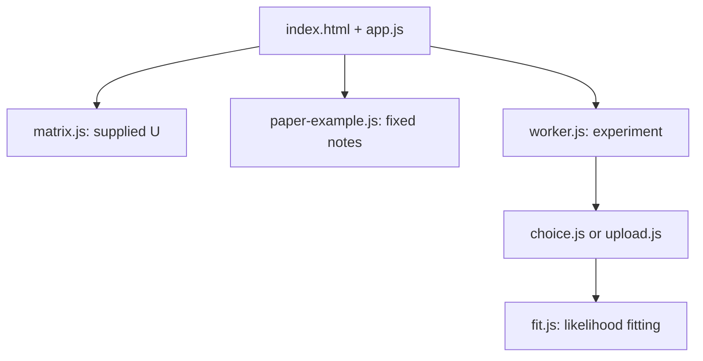

# Code Notes: Context Lab

This document explains **what each module and function does, what data it receives, and why the calculations are arranged this way**. It follows the current code. Start with the [README](README.md) if you first want to use the app.

## 1. Three questions, three computational paths

| Path | Given | Computed | Question answered |
| --- | --- | --- | --- |
| **Matrix Studio** | A user-edited 4 × 4 interaction matrix `U` | Factor matrices `T`, `C`; reconstruction `T Cᵀ`; off-diagonal RMSE | How well can rank `r` describe *these supplied interactions*? |
| **Experiment Lab** | Menus and chosen items, generated or uploaded | Parameters estimated by likelihood; train/validation/test NLL | How well does the model *predict choices it did not train on*? |
| **Paper Guide** | Six fixed toy choices and illustrative factor values from Nitesh's notes | Matrix products, menu scores, softmax probabilities, mean NLL | How do the equations work by hand? |

The Paper Guide's values are **not fitted**. Matrix Studio's least-squares factors are **not learned from choice observations**. Experiment Lab's fitted parameters are learned from choices. Keeping these paths separate prevents a visually small matrix error from being mistaken for good held-out prediction.

### Core notation

| Symbol / variable | Meaning |
| --- | --- |
| `n` | Number of distinct items |
| `r`, `rank` | Number of coordinates in each target/context vector |
| `U[x][z]` | Effect of context item `z` on target item `x`; direction matters |
| `T[x]`, `C[z]` | Target vector for `x`, context vector for `z` |
| `menu`, `S` | Items available for one choice |
| `chosen`, `y` | The item actually selected from that menu |
| `score`, `s_x(S)` | Sum of other available items' contributions to `x` |
| `NLL` | Average negative log-probability assigned to observed winners |

For a menu `S`, the essential pipeline is:

```text
target row x + context column z  →  U[x][z] = dot(T[x], C[z])
all z in S except x             →  score[x] = sum(U[x][z])
scores for items in S            →  softmax(scores)
chosen item's probability       →  -log(P(chosen | S))
```

The diagonal of `T Cáµ€` may contain numbers, but `x = z` is skipped when computing menu scores.

## 2. Project execution map



`src/math.js` provides arithmetic shared by the other modules. `styles.css` only controls presentation. The module script in `index.html` loads `src/app.js`, which binds controls and initializes all three views. The experiment runs in a Web Worker so fitting does not block the interface.

### UI state in `src/app.js`

| State field | Purpose |
| --- | --- |
| `matrix` | Current editable four-item source matrix |
| `rank` | Selected Matrix Studio rank |
| `selectedCell` | Target/context pair displayed in the dot-product inspector |
| `fits` | Cached rank 1–4 matrix reconstructions for the current source matrix |
| `worker` | Active experiment worker, or `null` |
| `result` | Latest experiment/scaling result for rendering and CSV export |
| `uploadedData` | Locally parsed user choice data, or `null` |

Paper Guide rank and observation selection are **local state inside `initPaperExample()`**. They do not change the four-item Matrix Studio or any experiment data.

## 3. Function reference

### `src/math.js` — small numerical building blocks

| Function | Inputs → output | Responsibility |
| --- | --- | --- |
| `seededRandom(seed)` | Integer → function yielding `[0,1)` values | Deterministic linear congruential pseudorandom stream. Calling the returned function advances its internal state. |
| `normal(random)` | Uniform RNG → one normal draw | Box–Muller transform for synthetic parameters and factor starts. |
| `dot(a, b)` | Equal-length vectors → scalar | Sum of coordinatewise products. |
| `softmax(values)` | Scores → probabilities | Subtracts the maximum before exponentiating to reduce overflow. |
| `solveLinear(system, right)` | Small square system → solution vector | Gauss–Jordan elimination with pivoting; throws on a near-singular pivot. |
| `format(value, digits)` | Number → display string | Rounds for UI and avoids showing tiny values as negative zero. Calculations retain full numeric precision. |

The seeded generator updates a 32-bit state by

```text
state_next = (1664525 × state + 1013904223) modulo 2^32
uniform = state_next / 2^32
```

It is a reproducible teaching tool, not a cryptographic random generator. `normal()` turns uniform draws into approximately standard-normal values. A seed specifies a repeatable *sequence*; the program's sampling and optimizer rules decide how that sequence is used.

### `src/matrix.js` — fit factors to known interactions

| Name | Inputs → output | Responsibility |
| --- | --- | --- |
| `ITEM_NAMES`, `EXAMPLE_MATRIX`, `RANK_ONE_MATRIX` | Constants | Four display labels and two example source matrices. |
| `copyMatrix(matrix)` | Matrix → independent row copies | Prevents editing a preset constant by reference. |
| `reconstruct(target, context)` | `n × r` and `n × r` → `n × n` | Computes every dot product, including display-only diagonal cells. |
| `offDiagonalRMSE(original, approximation)` | Two matrices → scalar | Square root of average squared difference for `x ≠ z` only. |
| `leastSquares(vectors, values, rank, ridge)` | Design rows and target values → vector | Solves a small normal-equation system; tiny ridge is used by default. Internal helper. |
| `alternatingLeastSquares(matrix, target, context, rank)` | Source and initial factors → fitted factors + error | For 120 rounds, updates target rows using fixed context rows, then context rows using fixed target rows. Internal helper. |
| `exactRankThree(matrix)` | Four-item matrix → rank-3 factors | Fixes four target rows so each context vector solves its three observed interactions exactly. Internal helper. |
| `fitMatrixAtAllRanks(matrix)` | Four-item matrix → rank 1–4 fit records | Ranks 1–2: 12 seeded starts each, keep the lowest RMSE. Rank 3: explicit exact construction. Rank 4: identity-based exact construction. |

`fitMatrixAtAllRanks()` uses fixed start seeds `7300 + 100 × rank + restart` for ranks 1–2. The algorithm may find a local minimum. A rank-2 fallback embeds the rank-1 solution if its numeric fit is worse. A zero rank-3 or rank-4 RMSE is a property of this **four-item, off-diagonal** setup; it does not imply the choice model generalizes.

### `src/choice.js` — menus, truth, winners, splits

| Function | Inputs → output | Responsibility |
| --- | --- | --- |
| `utilitiesFromMatrix(matrix, menu)` | Matrix + item indices → menu scores | Sums `matrix[x][z]` for every other `z` in the offered menu. |
| `choiceProbabilities(matrix, menu)` | Matrix + menu → probabilities | Applies stable softmax to those scores. |
| `sampleMenu(n, mode, random)` | Item count, sampling mode, RNG → menu | `all`: uniformly choose a subset of size ≥ 2; `pairs`: pair only; `mixed`: choose size 2 or 3 with probability 1/2 each, then sample distinct items. |
| `makeTruth({n, source, seed, scale})` | Synthetic settings → MNL scores or CDM matrix | Creates centered MNL scores, rank-2 factors and their matrix, or independently drawn full-CDM off-diagonal values. |
| `truthProbabilities(truth, menu)` | Synthetic truth + menu → probabilities | Dispatches to MNL softmax or CDM choice probabilities. |
| `generateChoices(config)` | Synthetic config → truth, preview, train/validation/test | Samples menus and winners, then shuffles and splits 70/15/15. |
| `splitObservedChoices(rows, seed)` | Uploaded indexed rows + seed → split | Copies and seeded-shuffles uploaded observations. No known true matrix is returned. |

Synthetic truth uses a seed offset inside `makeTruth()`, while `generateChoices()` uses the configured seed to draw menus and winners. `runScalingStudy()` may pass an explicit `truthSeed` to hold truth fixed across trials. A preview shows five rows **after** the shuffle, not necessarily the first five generated rows.

### `src/upload.js` — intentionally strict CSV input

| Function | Inputs → output | Responsibility |
| --- | --- | --- |
| `parseChoiceCSV(text)` | CSV text → `{labels, rows}` | Checks exact `menu,chosen` header, row count, labels, distinct menu members, and membership of the chosen item. Sorts item labels and maps them to indices. |

Accepted rows look like `Chai|Coffee|Juice,Coffee`. This parser is deliberately limited; it does not infer availability columns from an arbitrary research dataset, and it does not implement general CSV quoting with embedded commas. The UI also rejects files of 2 MB or more. Upload remains local to the browser.

### `src/fit.js` — likelihood estimation and evaluation

| Function | Inputs → output | Responsibility |
| --- | --- | --- |
| `initialParameters(kind, n, rank, seed)` | Model specification → `Float64Array` | MNL and full CDM begin at zeros; low-rank coordinates start as seeded normal draws multiplied by `0.16`. Internal helper. |
| `menuUtilities(parameters, kind, n, rank, menu)` | Parameters + menu → scores | MNL: one score per item. Full CDM: sum stored directed interactions. Rank model: sum target/context coordinate products. Internal helper. |
| `evaluate(parameters, kind, n, rank, data)` | Model + observations → `{nll, accuracy}` | Mean unregularized NLL and top-probability accuracy. |
| `gradient(parameters, kind, n, rank, data, regularization)` | Parameters + training rows → gradient | Uses softmax residual `P(x|S) − 1{x=chosen}` and the chain rule; adds L2 gradient. Internal helper. |
| `fitModel({...})` | Kind, rank, train, validation, seed → model record | Adam optimization, validation checkpointing, early stopping, final train/validation metrics. |
| `modelMatrix(model, n)` | Fitted rank/full model → interaction matrix | Reconstructs off-diagonal effects; MNL returns `null`. |
| `centeredMatrixRMSE(truth, estimate)` | Two CDM matrices → scalar | Subtracts each matrix's off-diagonal mean before calculating RMSE. |
| `runExperiment(config, report)` | Config + progress callback → rank-comparison result | Shared data split; MNL, each rank and restarts, full CDM; validation selection; final test evaluation. |
| `runScalingStudy(config, report)` | Synthetic CDM config + callback → scaling result | Four nested training sizes, three trials, fixed truth, full-CDM fits, mean centered MSE and SE. |

#### Optimization in `fitModel()`

The fitted objective is training mean NLL with a small L2 penalty; `evaluate()` reports **NLL without the penalty**. The default regularization coefficient is `0.001`. Adam uses learning rate `0.045` for low-rank factors and `0.07` for MNL/full CDM, first/second moment coefficients `0.9`/`0.999`, and numerical epsilon `1e-8`. It runs at most **240 epochs**. Every five epochs it checks validation NLL; after epoch 90, it stops when 18 checks fail to improve by at least `1e-5`. The returned parameters are the **best validation checkpoint**, not necessarily the final epoch's parameters.

One training row contributes a residual of `P(x|S) − 1{x=y}` for each available target `x`. For low-rank CDM, the derivative reaches both the target vector of `x` and the context vectors of the other menu members through `u[x,z] = dot(t[x], c[z])`. This is why a single observed choice can update several parameters.

#### Model selection in `runExperiment()`

1. Generate data or split uploaded choices **once**.
2. Fit MNL and full CDM baselines. For each rank `r = 1, …, min(4,n)`, fit the requested number of starts with seed `seed + 10000 + 100r + restart`.
3. Keep the lowest-**validation-NLL** restart for each rank, then choose the lowest-validation-NLL rank.
4. Evaluate the selected rank, MNL, and full CDM on the held-out test set. Do not use test NLL to pick a rank.

The CSV export leaves `test_nll` blank for unselected low-rank models. `recoveryRMSE` exists only when the synthetic data source has a true CDM matrix. Raw stored parameter counts (`n`, `2nr`, `n(n−1)`) are not identifiable dimension counts.

#### Why center recovery error?

If the same constant `a` is added to every off-diagonal interaction, each menu item receives `(|S|−1)a` extra utility. Softmax probabilities remain the same because all items in that menu shift together. `centeredMatrixRMSE()` therefore compares each matrix after subtracting its own off-diagonal mean. It is still a parameter-recovery diagnostic, distinct from predictive test NLL.

### `src/paper-example.js` — Nitesh's worked example

| Name | Inputs → output | Responsibility |
| --- | --- | --- |
| `NOTE_ITEMS`, `NOTE_CODES` | Fixed arrays | Chai `A`, Coffee `B`, Juice `J`. |
| `NOTE_OBSERVATIONS` | Six fixed `{menu, chosen}` rows | Same observed choices for ranks 1, 2, and 3. |
| `NOTE_FACTORS` | Target/context arrays keyed by rank | Illustrative **initial**, not fitted, values transcribed from the notes. |
| `factorProduct(rank)` | Rank → 3 × 3 matrix | Dot product of each target row with each context row. |
| `observedChoice(rank, observationIndex)` | Rank + row index → scores, probabilities, NLL | Uses the shared CDM utility and softmax functions. |
| `meanExampleNLL(rank)` | Rank → mean NLL of six rows | Arithmetic comparison of the displayed initial factors. |
| `initPaperExample()` | DOM initialization → interactive guide | Creates observation buttons, connects rank buttons, and renders the factors, matrix, scores, and NLL table. |
| `fixed(value, places)`, inner `render()` | Numbers → display strings; current selection → DOM | Internal display helpers. The calculation functions above retain full precision. |

At rank 1, `t_A = (0.2)` and `c_B = (0.5)`, so `u_AB = 0.10`. At rank 2, `u_AB = 0.2(0.5) + 0.1(0.1) = 0.11`; at rank 3, one more product `0.3(0.4)` makes it `0.23`. For observation 6, the available menu is `{A,B,J}` and Coffee was chosen. The current notes example has these **illustrative** results:

| Rank | `u_AB` | `P(B | {A,B,J})` | Mean NLL across six choices |
| ---: | ---: | ---: | ---: |
| 1 | 0.10 | 0.3535 | 0.7510 |
| 2 | 0.11 | 0.3651 | 0.7425 |
| 3 | 0.23 | 0.3398 | 0.7536 |

Rank 2 has the lowest NLL **for these hand-chosen initial factors**. This table is not an optimized rank comparison. With only three items, rank 3 is mainly a transparent arithmetic example, not a parameter-saving construction.

### `src/worker.js` — background job contract

The worker listens for `{task, config}`. `task = "scaling"` calls `runScalingStudy()`; any other task calls `runExperiment()`. It sends one of three message types to `app.js`: `{type:"progress", progress}`, `{type:"result", result}`, or `{type:"error", message}`. `app.js` terminates the worker on completion, failure, or cancellation. The experiment code has no network upload step.

### `src/app.js` — interface functions

This module is the browser entry point. The table groups its functions by responsibility so their dependencies are easier to follow.

| Function(s) | Role |
| --- | --- |
| `byId` | Local shortcut for `document.getElementById`. |
| `element`, `axis`, `diagonal` | Create common DOM elements for matrices and labels. |
| `setView` | Show one view and update the URL fragment (`#matrix`, `#experiment`, `#paper`). |
| `renderSource` | Draw editable off-diagonal matrix inputs; validate each edit in `[-3,3]`; refit after a valid change. |
| `renderFactor`, `renderReconstruction`, `renderErrors` | Draw factor rows, reconstructed matrix and selected-cell dot product, and RMSE-by-rank controls. |
| `probabilityRows`, `oddsRatio`, `renderChoices` | Compute and display menu probabilities and a fixed A/B odds comparison before/after adding C. |
| `renderMatrixResults`, `updateMatrix`, `setRank`, `loadPreset` | Refit/cache or redraw the Matrix Studio after edits, rank changes, and presets. |
| `readConfig`, `updateDataSource`, `handleUpload` | Read and validate form settings; toggle upload UI; parse a local CSV. |
| `setRunning`, `startExperiment`, `cancelExperiment` | Manage worker lifecycle, progress, cancellation, and completion. |
| `chartSVG`, `resultTable`, `renderResults` | Construct the rank-comparison chart, metrics table, test summary, and warnings. |
| `scalingChart`, `renderScalingResults` | Construct the scaling curve, trial table, and `1/m` guide. |
| `downloadResults`, `saveCSV` | Convert the latest result into CSV and trigger a browser download. |

At the end of `app.js`, event listeners are registered, Matrix Studio is initially rendered, `initPaperExample()` is called, and the starting URL fragment selects the initial view. Rounding in the UI is for readability; the math modules use full JavaScript `Number` values.

## 4. Invariants, tests, and edits

### Mathematical and workflow checks

Run `npm test` in the project root. The test file currently checks directed utilities and normalized probabilities, fixed-seed repeatability, the exact four-item rank-3/4 reconstruction property, uploaded CSV validation, fitting/scaling outputs, and the worked notes' rank 1–3 numbers. It does not prove general convergence or validate every browser layout.

For a quick manual check, serve the project with `python3 -m http.server 8000` and:

1. On `#matrix`, change one off-diagonal entry and verify the fit/error/probabilities update; switch ranks and inspect a cell.
2. On `#paper`, switch ranks 1–3 and observations 1 and 6; verify factors, scores, probability, and mean NLL change as expected.
3. On `#experiment`, run a small synthetic comparison and verify selection uses validation NLL, then download its CSV.

### Where to make a future change

| Goal | Edit first | Then check |
| --- | --- | --- |
| Change the handwritten worked example | `NOTE_FACTORS` or `NOTE_OBSERVATIONS` in `src/paper-example.js` | Expected values in `tests/model.test.js`, the guide copy in `index.html`, and the example table in this file. |
| Change the four-item preset | `EXAMPLE_MATRIX` / `RANK_ONE_MATRIX` in `src/matrix.js` | Matrix Studio tests and explanatory copy. |
| Change the experimental sampling scheme | `sampleMenu()` in `src/choice.js` and form options in `index.html` | Seed reproducibility and menu coverage. |
| Change optimizer behavior | `fitModel()` / `gradient()` in `src/fit.js` | Tests, README methods section, and comparison interpretation. |
| Add a new CSV field or data source | `parseChoiceCSV()` in `src/upload.js`, `readConfig()` in `src/app.js` | Error messages, data privacy wording, and tests. |
| Change labels, results, or charts | `index.html`, `src/app.js`, `styles.css` | Narrow-screen layout and CSV column meaning. |

Keep the data split and ranking logic explicit. Whenever a displayed statistic changes definition, update its label, its README explanation, and at least one check against a small known example.

## 5. Research boundaries and credit

- CDM theory and low-rank construction originate with [Seshadri, Peysakhovich, and Ugander (ICML 2019)](https://proceedings.mlr.press/v97/seshadri19a.html).
- The Chai–Coffee–Juice teaching example and explanations come from **Nitesh Kumar Shah's original study notes**, developed under the supervision of **Prof. Suryanarayana Sankagiri**, IIT Madras. The displayed six choices and factor values are pedagogical, not the ICML paper's datasets or fitted parameters.
- Matrix Studio uses a supplied interaction matrix; Experiment Lab fits observed winners; Paper Guide uses chosen starting factors. They are related explanations of the model, not interchangeable numerical estimators.
- The browser scaling curve and synthetic rank comparison are exploratory. A faithful paper reproduction needs the original data, preprocessing, baselines, split protocol, optimizer settings, and repeated trials.